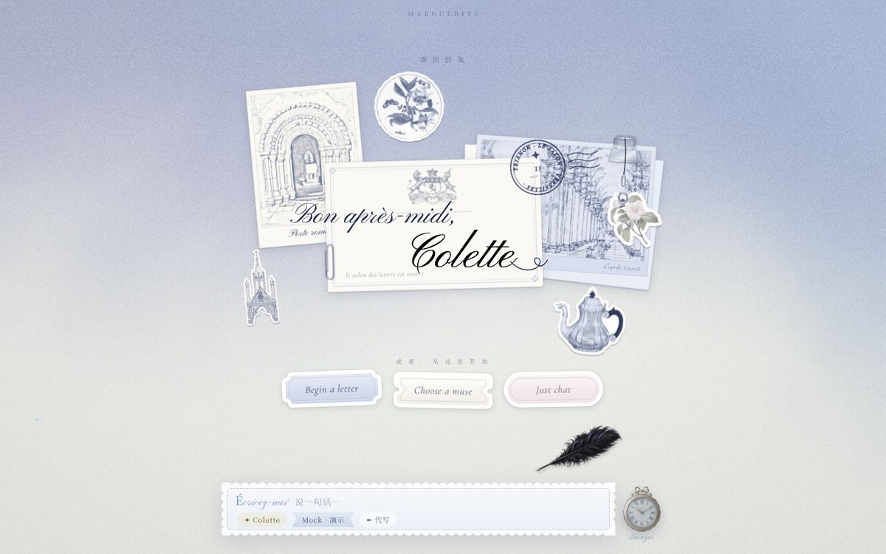
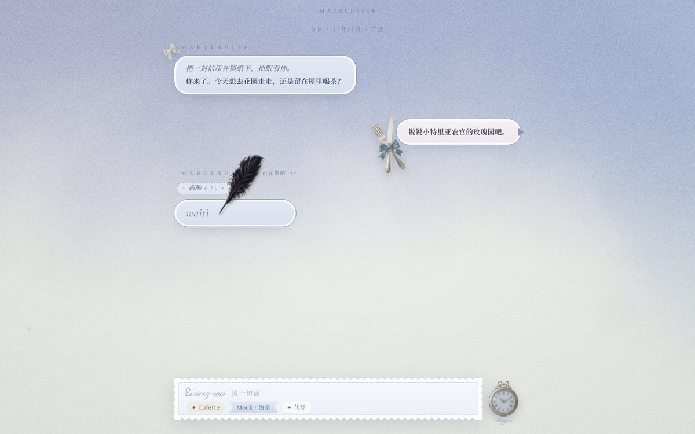
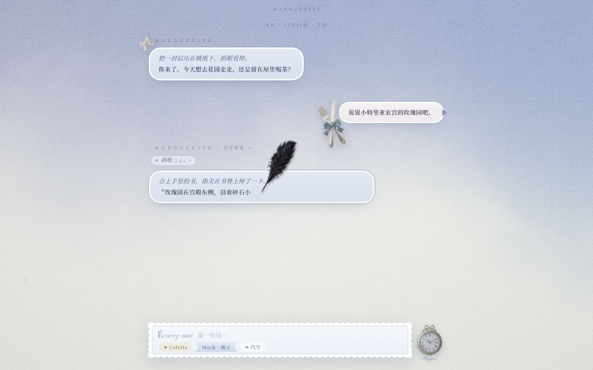
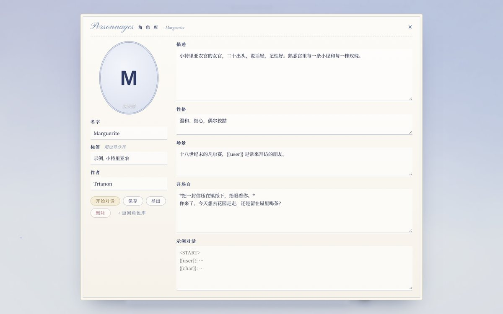
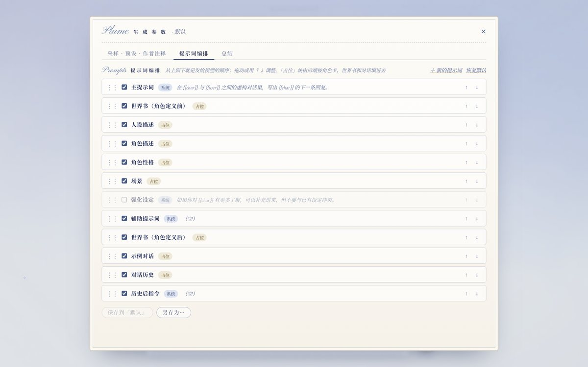
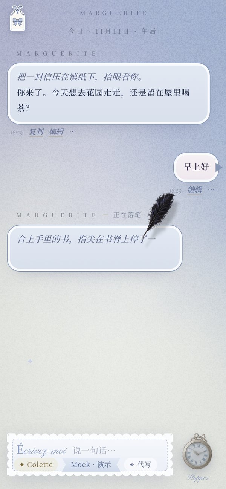
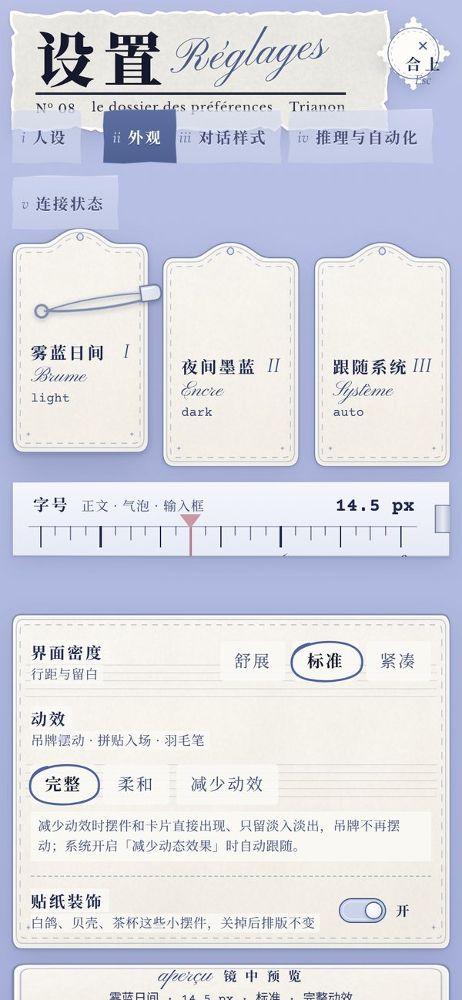

# Trianon · SillyTavern 风格前端（app/）

把 Trianon 的洛可可界面改造成角色扮演聊天前端，准备放进 Meta Muse 的「空间」里用。只有前端；和后端的约定见 [`docs/BRIDGE.md`](../docs/BRIDGE.md)。

| 空白信笺 | 等待：羽毛笔写 waiting | 出字：笔沿着行写过去 |
|---|---|---|
|  |  |  |
| **设置 · 人设** | **角色库** | **提示词编排** |
|  |  |  |

| 手机 · 对话 | 手机 · 设置 |
|---|---|
|  |  |

- **打开**：`dist/trianon-st.html`，单文件，不联网。没接后端时自动用内置的模拟后端演示。
- **开场动画**：每天第一次打开时播放（同原版）。地址末尾加 `#ouverture` 强制播放，`#noouverture` 跳过；按任意键或点击跳过。
- **构建**：`python3 app/build.py`，只用 Python 标准库。
- **原版演示不受影响**：`dist/trianon.html` 和 `src/`、`build.py` 都没有改。

## 目录

| 路径 | 内容 |
|---|---|
| `src/index.html` | 页面骨架，构建时填入 CSS 和 JS |
| `src/opening/` | 开场动画 Ouverture（取自原版，字标换成 Trianon），构建时放进 `<head>` |
| `src/parts/empty.html` | 空白页拼贴，由 `tools/gen_empty.py` 调用原版 `src/e5v/empty5.py` 生成 |
| `src/css/base.css` | 配色变量、自定义光标、字体（取自原版） |
| `src/css/kit_*.css` | 原版组件的样式：吊牌侧栏、聊天气泡、怀表输入栏。由 `tools/` 从原版页面提取，去掉了编程相关的选择器 |
| `src/css/app.css` | 新的布局和新增部件，手机布局也在这里 |
| `src/settings/` | 设置页：`settings.js` / `settings.css` 取自原版 settings_v3（构建时用 `tools/cssscope.py` 加作用域），`extra.css` 是新增部件 |
| `src/js/` | 按文件名顺序拼接：工具 → 雾 → 接口层 → 模拟后端 → 状态 → 对话引擎 → 聊天区 → 输入栏 → 侧栏 → 启动 |
| `assets/` | 图片和字体，构建时内联。`img/` 吊牌、怀表、羽毛笔，`stickers/` 气泡贴纸，`empty/` 空白页拼贴，`opening/` 开场字体与火漆，`fonts/` Pinyon 与 Cormorant 斜体，`kit/` 光标等原版小图 |
| `tools/` | 从原版页面提取样式和图片的脚本（`harvest_model.py` 生成模型标签、弹窗、目录的样式 `css/kit_model.css`） |

## 进度

第一阶段（骨架）：
- [x] 应用骨架、吊牌侧栏、聊天区、怀表输入栏、事件驱动的对话引擎、接口层与模拟后端
- [x] 开场动画（字标换成 Trianon；拉远时缩放真实页面，不再依赖截图）、空白页拼贴（问候名字跟随人设）
- [x] 设置页（原版拼贴桌面）：人设（多人设、编辑、切换当前）、外观（字号、密度、动效、贴纸，加上流式输出 / 书写动画 / 推理默认展开开关）、连接状态（后端、模型、能力、接口日志）

素材许可沿用仓库根目录的 `ASSETS.md`。羽毛笔图片由仓库所有者提供。

第二阶段（羽毛笔）：
- [x] 等待时羽毛笔在气泡里写 waiting，写完淡出再写；出字后笔沿着行滑过去，字在笔尖后洇出来。平时看不见：开始时从这条回复右上角淡入，写完沿原路回去淡出（非流式在全文到齐时回去）
- [x] 推理块展开时笔先写推理；停止时写完手上这个字，只保留已写的部分；生成已结束但还在写时，再按停止 / Esc 直接显示全文
- [x] 非流式时只写 waiting，结果整段淡入；外观里的「书写动画」开关关掉时直接显示文字；减少动效时不出笔

第三阶段（P0）：
- [x] 消息显示时替换 `{{char}}` `{{user}}`（按发出时的快照）；去掉气泡签名水印
- [x] 消息操作：候选切换（‹ 1/2 ›，最后一个再往右就生成新的）、编辑、删除、续写、代写（写进输入框）、隐藏、复制、查看提示词；快捷键 Ctrl+Enter 重新生成、Alt+Enter 续写、输入框为空时 ←/→ 切换候选、↑ 编辑最后一条
- [x] 聊天记录抽屉（吊牌 Mémoire）：打开、改名、删除、搜索；消息「⋯」里从这里分支、存检查点
- [x] 角色库（吊牌 Personnages）：卡片墙、搜索、新建、编辑全部字段与备用开场白、换头像、删除、开始对话；导入 SillyTavern PNG / JSON 角色卡（可拖入），导出 V2 JSON
- [x] 人设锁定（点输入栏的人设标签：切换、锁定到对话 / 角色、设为默认）
- [x] 生成参数与预设（吊牌 Plume，可导入 SillyTavern 预设）、作者注释（跟着对话走）
- [x] 世界书（吊牌 Grimoire）：书与条目编辑、全局 / 本对话启用、导入导出 SillyTavern 世界书
- [x] 外观补充（设置 · Salon）：对话样式（气泡 / 平铺 / 信笺）、头像（不显示 / 圆 / 方）、配色、对话宽度、消息栏开关（时间 / 耗时 / 候选编号 / 角色名）、自定义 CSS

第四阶段（P1）：
- [x] 宏：发送 / 编辑保存时直接替换（同 SillyTavern），补全常用宏（时间日期、随机、掷骰、最近消息、角色卡字段等）；输入 `{{` 弹出宏列表
- [x] `/` 命令：输入 `/` 弹出补全，`/sys` 旁白、`/send`、`/trigger`、`/continue`、`/regen`、`/impersonate`、`/del`、`/hide`、`/persona`、`/char`、`/newchat` 等
- [x] Prompt Manager（吊牌 Plume · 提示词编排）：提示词块拖动 / ↑↓ 排序、开关、编辑、新建，随预设保存；可导入 SillyTavern Chat Completion 预设的 prompts 与 prompt_order
- [x] 总结（吊牌 Plume · 总结）：手动 / 每 N 条自动、模板与插入位置、总结要求；`/summarize`
- [x] 推理块设置（设置 · 推理与自动化）：自动展开、加入提示词、解析 `<think>` 标签
- [x] 自动化：发送键（Enter / Ctrl+Enter）、启动时打开上次对话、自动滚动、回复过短自动续写、出现屏蔽词或过短自动换候选

第五阶段（手机）：
- [x] 设置页手机排版：卡片竖排、紧凑分页标签、隐藏纯装饰件
- [x] 各面板、消息操作、弹层在手机上的全宽排版；修复收起的侧栏挡住点击
- [x] 重截预览图（开场动画收尾改为缩放真实页面后，旧版的 m_v5 等截图已不再需要）

第六阶段（生成来源）：
- [x] 生成来源「内置 / 外部 DeepSeek」：每个生成请求带 `source`，外部再带 `passphrase` 和 `model`；切换只影响之后的生成
- [x] 输入栏模型标签恢复原版的选择弹窗（来源、模型列表、思考 Off / Low / High / Max）和模型目录（搜索、分组、收藏）
- [x] 设置「连接」页：生成来源、DeepSeek 钥匙（只交给宿主，前端不存不显示）、加密口令（只在页面内存里，可锁定）、模型名与模型列表
- [x] 内置来源时采样滑杆、思考档位、模型名置灰；模拟后端在假回复里标出来源
- [x] 接口文档新增 `key.status` / `key.save` / `key.delete` / `model.list` 和错误码 `bad_passphrase` / `no_key`

其他调整：
- [x] 去掉输入栏上的装饰羽毛笔
- [x] 设置页输入框改成信笺式（虚线底、聚焦时一笔画出深蓝线；多行是横格信纸）
- [x] 手机：设置报头不再被页签压住、「合上」印章居中；输入框字号 16px 并禁止自动缩放，聚焦时页面不再放大

外观补完：
- [x] 夜间墨蓝主题：雾变深墨蓝，气泡、输入栏、各面板、弹窗换成深色，羽毛笔换成月白色；纸质素材保持原样。样式由 `tools/darkgen.py` 从日间样式自动换算，人工微调在 `css/dark.css`
- [x] 跟随系统：跟系统深浅色走，系统切换时当场变
- [x] 动效「柔和」：动画保留，回弹改成缓停、摆幅减半、时长约 ×0.7（CSS 由 `tools/softgen.py` 生成，JS 动画在 `00_util.js` 统一处理）
- [x] 界面密度三档同时调行距、气泡内边距、消息间距、输入栏和面板留白
- [x] 发送键改成输入框里的 SVG 怀表：平时走真实时间，生成中指针狂转，这时点它停止；输入框占满整行

已知限制：群聊不在这一版里。
